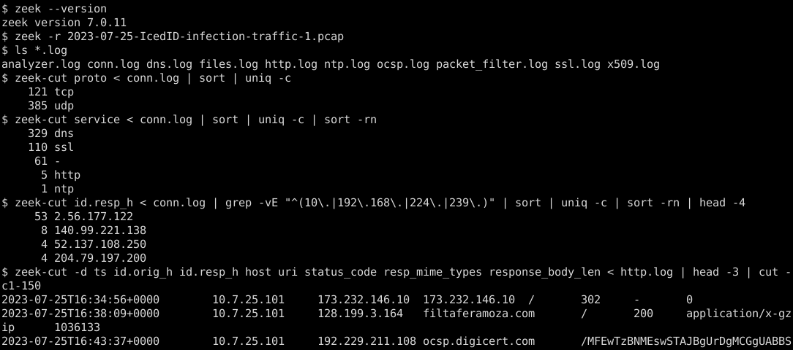
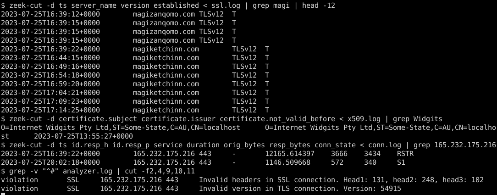

# Homework 3.1 – Network Traffic Analysis with Zeek

<div class="sub">CS 6349 Network Security &nbsp;·&nbsp; Amna Tahir &nbsp;·&nbsp; Worked solution &nbsp;·&nbsp; PCAP: <code>2023-07-25-IcedID-infection-traffic-1.pcap</code> (8,604 packets, 2023-07-25 16:34:56 – 20:21:46 UTC) &nbsp;·&nbsp; Zeek 7.0.11 LTS</div>

## Part 1 – Getting started with Zeek

The pcap was unzipped with the password `infected_20230725`. Only the `.pcap` was analyzed; no other file was extracted or run. Zeek was run in an empty folder twice: once for tab-separated logs and once for JSON logs.

```
$ zeek --version
zeek version 7.0.11
$ zeek -r 2023-07-25-IcedID-infection-traffic-1.pcap                          # TSV logs
$ zeek -r 2023-07-25-IcedID-infection-traffic-1.pcap LogAscii::use_json=T     # JSON logs (separate folder)
$ ls *.log
analyzer.log conn.log dns.log files.log http.log ntp.log ocsp.log packet_filter.log ssl.log x509.log
```

| Log | Records | Log | Records |
|---|---|---|---|
| conn.log | 506 | x509.log | 31 |
| dns.log | 310 | files.log | 11 |
| ssl.log | 110 | analyzer.log | 2 (protocol violations) |
| http.log | 6 | notice.log / weird.log | not created (0 events) |

`zeek-cut` was used to read the TSV logs and `jq` for the JSON logs (examples in each answer). All times are UTC.


<p class="cap">Figure 1 – Zeek run, the logs it produced, and the conn.log / http.log summaries used for Q1 and Q3.</p>

## Part 2 – Assignment Questions

### 1. Connections (conn.log)

**How many unique internal IP addresses appear?**

<div class="ans"><b>3 internal hosts</b>: <code>10.7.25.101</code>, <code>10.7.25.1</code> and <code>192.168.68.1</code>. A 4th private address, <code>10.7.25.255</code>, is the subnet <i>broadcast</i> address rather than a host. Counting every RFC 1918 address in conn.log gives 4.</div>

| Internal IP | What it is (evidence) |
|---|---|
| **10.7.25.101** | The **infected Windows client** `DESKTOP-K225LHK` (name from its own NetBIOS/mDNS traffic). It originates every TCP connection in the capture. |
| 10.7.25.1 | LAN gateway / DNS server – target of all 169 DNS queries on 53/udp |
| 192.168.68.1 | A UPnP device that answered the client's SSDP `M-SEARCH` (2 UDP 1900 replies at 20:02 and 20:17) |
| 10.7.25.255 | Broadcast address for NetBIOS (137/138) – not a host |

`zeek-cut id.orig_h id.resp_h < conn.log | tr '\t' '\n' | grep -E '^(10\.|172\.(1[6-9]|2[0-9]|3[01])\.|192\.168\.)' | sort -u`

**Which external IP receives the most connections?**

<div class="ans"><b>2.56.177.122</b>, with <b>53 connections</b>, all TCP/443 TLS. It hosts the IcedID C2 domains <code>magizanqomo.com</code> (8) and <code>magiketchinn.com</code> (45). Next are 140.99.221.138 (8) and Microsoft/Bing addresses (≤ 4 each).</div>

**Which protocols are most commonly used?**

| Transport | Connections | Zeek `service` | Connections | Bytes (orig+resp) |
|---|---|---|---|---|
| UDP | **385 (76 %)** | dns* | **329** | 54 kB |
| TCP | 121 (24 %) | ssl (TLS) | 110 | **3.58 MB** |
| | | `-` (unidentified) | 61 | 30 kB |
| | | http | 5 | 1.04 MB |
| | | ntp | 1 | 96 B |

<div class="ans">By number of connections: <b>UDP / DNS</b> is most common (Windows name resolution). By volume: <b>TLS (ssl) on TCP/443</b> dominates with 3.58 MB, followed by <b>HTTP</b> at 1.04 MB, which is almost entirely the malware download.</div>

\*Zeek's DNS analyzer also parses NetBIOS-NS (137/udp, 129 conns), LLMNR (5355) and mDNS (5353), so these appear as `dns`. The 61 unidentified connections are NetBIOS datagrams (138/udp), SSDP (1900/udp) and **two TCP/443 connections to 165.232.175.216 that are not TLS** (see Q4/Q5).

### 2. DNS (dns.log)

**What domains were queried?** dns.log has **36 distinct query names**. That's 33 real DNS names plus NetBIOS names (`WORKGROUP`, `MACBOOKPRO-B348`, upper/lower-case `DESKTOP-K225LHK`). Most are normal Windows/Office background traffic:

<p class="cap" style="font-style:normal">Normal: dns.msftncsi.com (18), v10.events.data.microsoft.com (14), settings-win.data.microsoft.com, licensing.mp.microsoft.com, self.events.data.microsoft.com, www.bing.com, ctldl.windowsupdate.com, evoke-windowsservices-tas.msedge.net, officeclient.microsoft.com, clients.config.office.net, ow1.res.office365.com, fp-vs-nocache.azureedge.net, edge.microsoft.com, pti.store.microsoft.com, fe2cr.update.microsoft.com, fe3cr.delivery.mp.microsoft.com, login.live.com, maps.windows.com, ocsp.digicert.com, time.windows.com, storecatalogrevocation.storequality.microsoft.com, ecs.office.com, client.wns.windows.com, plus local names wpad.localdomain (81), localdomain.localdomain, desktop-k225lhk(.local).</p>

**Do any domains look suspicious or unusual?** Yes. Six names stand out:

| Domain | Answer | Queries | Why suspicious |
|---|---|---|---|
| www.sophrologie-yoga.fr | 109.234.165.110 | 1 | Unrelated French yoga site, reached right after a 302 from a raw IP. The ≈201 kB HTTPS download (conn.log) is the initial infection file |
| **filtaferamoza.com** | 128.199.3.164 | 1 | Random, pronounceable, nonsense name; serves the IcedID payload (Q3) |
| **magizanqomo.com** | 2.56.177.122 | 7 | Random name; IcedID C2 with a self-signed cert |
| **magiketchinn.com** | 2.56.177.122 | **87** | Random name; re-resolved constantly – the beacon target |
| lohmotarufos.com | 140.99.221.138 | 5 | Random name; backup C2 tried from 20:05 when the main C2 stopped answering – every connection reset |
| flarkonafaero.com | 140.99.221.138 | 5 | Same pattern and IP as above |

Things that give them away: freshly invented `.com` names with no real-world meaning, several names sharing one IP, a very high query count (87), and the fact that the client goes straight on to talk TLS to them.

`zeek-cut query answers < dns.log | sort | uniq -c | sort -rn`

### 3. HTTP (http.log)

**Which websites were visited?** Over plaintext HTTP, there were 6 requests to 4 hosts:

| Time | Host | URI | Status | resp_mime_types | Body | User-Agent |
|---|---|---|---|---|---|---|
| 16:34:56 | 173.232.146.10 | `/` | 302 → https://www.sophrologie-yoga.fr/palatial | – | 0 | Edge 115 (browser) |
| **16:38:09** | **filtaferamoza.com** (128.199.3.164) | **`/`** | **200** | **application/x-gzip** | **1,036,133** | **none (`-`)** |
| 16:43:37 | ocsp.digicert.com | /MFEwTz… | 200 | application/ocsp-response | 471 | Microsoft-CryptoAPI |
| 17:49, 17:49, 19:19 | ctldl.windowsupdate.com | /…/disallowedcertstl.cab, authrootstl.cab | 304 | – | 0 | Microsoft-CryptoAPI |

Over HTTPS, ssl.log's `server_name` shows the user also reached **www.sophrologie-yoga.fr**, the C2 domains above, and Microsoft/Bing services.

**Was any file downloaded?** <span class="ans" style="display:inline-block"><b>Yes.</b> <code>GET http://filtaferamoza.com/</code> returned <b>application/x-gzip, 1,036,133 bytes</b> (files.log confirms <code>source=HTTP</code>, <code>mime_type=application/x-gzip</code>, <code>total_bytes=1036133</code>).</span>

The request has **no User-Agent**, the URI is just `/`, and there is no filename. This is the IcedID loader fetching its encoded payload. Suricata's ET rules flag this same request as `ET MALWARE Win32/IcedID Requesting Encoded Binary M4`. The other HTTP "files" are a 471-byte OCSP response and `304 Not Modified` replies from Windows Update, all benign.

```
$ jq -c 'select(.host=="filtaferamoza.com") | {host,uri,method,status_code,user_agent,resp_mime_types,response_body_len}' http.log
{"host":"filtaferamoza.com","uri":"/","method":"GET","status_code":200,"user_agent":null,"resp_mime_types":["application/x-gzip"],"response_body_len":1036133}
```

### 4. SSL/TLS (ssl.log, x509.log)

**Were any encrypted connections made?** <span class="ans" style="display:inline-block"><b>Yes – 110 TLS sessions</b> (93 established, 17 not; 92 TLS 1.2, 1 TLS 1.3).</span> Top SNIs: **magiketchinn.com (45)**, v10.events.data.microsoft.com (13), **magizanqomo.com (8)**, settings-win.data.microsoft.com (5), **flarkonafaero.com (4)**, **lohmotarufos.com (4)**, www.bing.com (4) and **www.sophrologie-yoga.fr (1)**.

**Did any certificates look self-signed or unusual?** <span class="ans" style="display:inline-block"><b>Yes.</b> The C2 server 2.56.177.122 presented a <b>self-signed</b> certificate (subject = issuer).</span>

```
subject     = O=Internet Widgits Pty Ltd, ST=Some-State, C=AU, CN=localhost
issuer      = O=Internet Widgits Pty Ltd, ST=Some-State, C=AU, CN=localhost      (self-signed)
serial      = D4B36C        key = RSA 2048
not_before  = 2023-07-25 13:55:27 UTC     not_after = 2024-07-24 13:55:27 UTC
```

Why this is unusual:

- `Internet Widgits Pty Ltd` / `Some-State` / `AU` are OpenSSL's **default placeholder values**.
- `CN=localhost` does not match the SNI (`magiketchinn.com`).
- The cert was **generated about 2 hours 44 minutes before** the first C2 connection (16:39:12).
- No public CA issued it.

Every other certificate chains to Microsoft Azure / DigiCert CAs. The only other self-signed entries are the genuine DigiCert *root* certificates, which are self-signed by design. Two more TLS anomalies:

- **165.232.175.216:443** – Zeek's analyzer.log records SSL *protocol violations* ("Invalid headers in SSL connection", "Invalid version … 54915"). Port 443 is being used for a **non-TLS custom protocol**.
- **Failed sessions after 20:05** – all 16 TLS attempts to 2.56.177.122 and 140.99.221.138 (lohmotarufos.com / flarkonafaero.com) end in RST (`conn_state RSTR`) with 0 response bytes; no certificate was sent. These are most of the 17 non-established sessions.


<p class="cap">Figure 2 – ssl.log shows the 5-minute C2 sessions; x509.log the self-signed "Internet Widgits" cert; conn.log + analyzer.log the 3.4-hour non-TLS session to 165.232.175.216.</p>

### 5. Behavioral analysis

**Signs of beaconing?** <span class="ans" style="display:inline-block"><b>Yes – three periodic channels.</b></span>

| Channel | Evidence from Zeek logs | Interval |
|---|---|---|
| **TLS to magiketchinn.com / 2.56.177.122:443** | 45 ssl.log sessions, 16:39:22 → 20:21:46 (41 established up to 20:00:25, then refused); 87 DNS look-ups of the same name | **mean 303.3 s, median 301.7 s, σ = 6.5 s** – a 5-minute timer |
| **165.232.175.216:443 (non-TLS)** | One connection lasting **12,165 s (3 h 23 m)** with only 3,666 B up / 3,434 B down, plus a second 1,147 s session; no DNS name | ≈17-byte heartbeat every 60 s (seen in packets) – IcedID **BackConnect** (remote access) |
| C2 fail-over (2.56.177.122 + 140.99.221.138) | From 20:05 the C2 server stops accepting. Every 5 min (20:05, 20:10, 20:16, 20:21) the bot tries **all four** C2 names – magiketchinn, magizanqomo, lohmotarufos, flarkonafaero – ~5 s apart; all 16 attempts fail (RST, `established=F`) | ~5 min – same timer, now cycling through a C2 list |

Normal periodic Windows traffic (NetBIOS every 120 s, SSDP/LLMNR/mDNS every 900 s) is local-only and expected. The 5-minute TLS beacon to an IP with a fresh self-signed cert is not.

**Evidence of data exfiltration?** <span class="ans" style="display:inline-block"><b>No large upload.</b> The host sent 279 kB to the Internet and received 4.36 MB.</span>

- The biggest upload is 36 kB, to Windows Update (fe2cr.update.microsoft.com, 20.62.190.191), which is benign.
- The C2 sessions are lopsided the other way. The first C2 session (16:39:12, magizanqomo.com) uploaded **1,059 B** and **downloaded 1,907,544 B**: IcedID pulling additional modules from the C2 server.

There *is* small-scale data theft. The IcedID HTTP request to filtaferamoza.com carries host-profiling data in its cookie: hostname `DESKTOP-K225LHK`, username `user`, bot ID and OS build `10.0.19045`, decoded in the Wireshark part. The low-volume C2 and BackConnect channels could also carry stolen data that we cannot see because it is encrypted or obfuscated.

`zeek-cut id.orig_h id.resp_h id.resp_p service orig_bytes resp_bytes < conn.log | sort -k5 -rn | head` (uploads) and `sort -k6 -rn` (downloads)

## 6. Report

**Likely compromise scenario.** Windows host **10.7.25.101 (DESKTOP-K225LHK, user "user")** was infected with **IcedID (BokBot)**, a banking trojan and malware loader often used as an initial-access foothold for ransomware operators. At 16:34:56 UTC the user's Edge browser visited `http://173.232.146.10/`, which 302-redirected to `https://www.sophrologie-yoga.fr/palatial`. About 201 kB was then downloaded over HTTPS; this was most likely the malicious file the user opened. Three minutes later (16:38:09) the newly running IcedID installer made a User-Agent-less `GET /` to the random domain **filtaferamoza.com (128.199.3.164)**. The request carried a host-profiling cookie, and the server returned a 1,036,133-byte `application/x-gzip` blob, IcedID's encoded payload. From 16:39 onward the bot talked to its C2 server **2.56.177.122** (magizanqomo.com, then magiketchinn.com) over TLS with a self-signed `CN=localhost / Internet Widgits Pty Ltd` certificate created that morning. It first downloaded ≈1.9 MB of follow-up modules and then **beaconed every ~5 minutes for 3.5 hours**. In parallel it opened a long-lived, non-TLS channel on port 443 to **165.232.175.216**, consistent with IcedID's BackConnect/VNC module giving an operator hands-on access. At 20:05 the C2 server stopped accepting connections. On the same 5-minute timer the bot then cycled through its whole C2 list – magiketchinn.com, magizanqomo.com and the backups lohmotarufos.com / flarkonafaero.com (140.99.221.138) – and every attempt was reset until the capture ended at 20:21.

**Supporting evidence.** conn.log: 53 connections to 2.56.177.122 (most-contacted external IP); a 1.9 MB C2 download; a 12,165-second connection to 165.232.175.216 with no recognized service; 4.36 MB down vs 279 kB up. dns.log: random-looking domains, with 87 look-ups of magiketchinn.com. http.log + files.log: the 1 MB `application/x-gzip` download from filtaferamoza.com with no User-Agent. ssl.log: 45 sessions to magiketchinn.com at a fixed 303-second interval (σ 6.5 s). x509.log: the self-signed C2 certificate with OpenSSL default fields, issued 2 h 44 m before first use. analyzer.log: protocol violations proving the 165.232.175.216 "HTTPS" traffic is not TLS. Recommended response: isolate 10.7.25.101 and reimage it, reset the user's credentials, block the listed domains/IPs at DNS and the firewall, and hunt for the same indicators on other hosts.

**Indicators of compromise:** 173.232.146.10, www.sophrologie-yoga.fr (109.234.165.110), filtaferamoza.com (128.199.3.164), magizanqomo.com / magiketchinn.com (2.56.177.122), 165.232.175.216:443, lohmotarufos.com / flarkonafaero.com (140.99.221.138), C2 cert serial D4B36C, payload SHA-256 729a9743319f548134a1535291bea0bfdac6cd9a8c4c9ba19ab1b8524d5ebea7.
