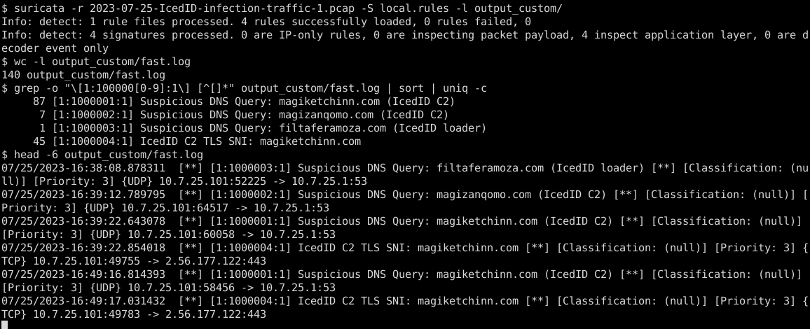

# Homework 3.2 – Network Traffic Analysis with Suricata IDS

<div class="sub">CS 6349 Network Security &nbsp;·&nbsp; Amna Tahir &nbsp;·&nbsp; Worked solution &nbsp;·&nbsp; PCAP: <code>2023-07-25-IcedID-infection-traffic-1.pcap</code> (8,604 packets, 2023-07-25 16:34:56 – 20:21:46 UTC)</div>

## Summary of results

| Deliverable | Answer |
|---|---|
| Total Suricata alerts (Emerging Threats ruleset) | **47** (`fast.log` = 47 lines, `eve.json` = 47 `alert` events, `stats.log` `detect.alert` = 47) |
| Types of threats detected | IcedID malware (loader download + C2 request cookie) and IcedID TLS command-and-control using a self-signed "Internet Widgits" certificate |
| Protocol with the most alerts | **TLS** – 45 of 47 alerts (95.7 %); HTTP – 2 (4.3 %); DNS – 0 |
| Domain targeted by custom rule | **`magiketchinn.com`** (IcedID C2, 2.56.177.122) – plus 3 supporting rules |
| Custom rule fired? | **Yes** – SID 1000001 fired **87** times (one per DNS query for the domain) |

## Part 1 – Setup

Suricata was installed and verified, then the Emerging Threats Open ruleset was downloaded from the URL in the assignment.

```
$ sudo apt-get install suricata          # (macOS: brew install suricata)
$ suricata --build-info | head -2
This is Suricata version 7.0.3 RELEASE
$ curl -LO https://rules.emergingthreats.net/open/suricata-7.0.3/emerging-all.rules.zip
$ unzip emerging-all.rules.zip            # -> emerging-all.rules (51,484 enabled rules)
$ mkdir output output_custom
```

Suricata 7.0.3 was used because it is the exact engine version the ruleset URL is built for (`suricata-7.0.3/`). All timestamps below are UTC.

## Part 2 – Run Suricata on the pcap

```
$ suricata -S ./emerging-all.rules -r 2023-07-25-IcedID-infection-traffic-1.pcap -l output/
i: pcap: read 1 file, 8604 packets, 5161681 bytes
Info: detect: 1 rule files processed. 51484 rules successfully loaded, 0 rules failed
```

Every rule loaded without error, and all 8,604 packets were processed. Suricata wrote `fast.log`, `eve.json`, `stats.log` and `suricata.log` to `output/`. The same 47 alerts appear whether or not checksum validation is disabled (`-k none`), so the count is stable.

## Part 3 – Analyze alerts

### Q1. How many alerts did Suricata generate with the ET ruleset?

<div class="ans"><b>47 alerts</b> involving 3 distinct signatures. The first alert is at 16:38:09 UTC and the last at 20:00:25 UTC.</div>

| # | SID | Signature | Classification | Priority | Count |
|---|---|---|---|---|---|
| 1 | 2030053 | ET MALWARE Win32/IcedID Requesting Encoded Binary M4 | Malware Command and Control Activity Detected | 1 (high) | 1 |
| 2 | 2032086 | ET MALWARE Win32/IcedID Request Cookie | A Network Trojan was detected | 1 (high) | 1 |
| 3 | 2011540 | ET INFO OpenSSL Demo CA - Internet Widgits Pty (O) | Not Suspicious Traffic | 3 (low) | 45 |
| | | | | **Total** | **47** |

```
$ wc -l output/fast.log
47 output/fast.log
$ head -3 output/fast.log
07/25/2023-16:38:09.829832  [**] [1:2030053:12] ET MALWARE Win32/IcedID Requesting Encoded Binary M4 [**]
   [Classification: Malware Command and Control Activity Detected] [Priority: 1] {TCP} 10.7.25.101:49748 -> 128.199.3.164:80
07/25/2023-16:38:09.829832  [**] [1:2032086:4] ET MALWARE Win32/IcedID Request Cookie [**]
   [Classification: A Network Trojan was detected] [Priority: 1] {TCP} 10.7.25.101:49748 -> 128.199.3.164:80
07/25/2023-16:39:12.983342  [**] [1:2011540:7] ET INFO OpenSSL Demo CA - Internet Widgits Pty (O) [**]
   [Classification: Not Suspicious Traffic] [Priority: 3] {TCP} 2.56.177.122:443 -> 10.7.25.101:49751
```

### Q2. What types of malicious activity were flagged?

**1. IcedID malware download / loader C2 over HTTP (2 alerts, Priority 1).** At 16:38:09 UTC the infected Windows host **10.7.25.101** sent `GET /` to **filtaferamoza.com (128.199.3.164:80)**. The request carried the IcedID cookie `__gads=…; _gid=…; _u=…; __io=…; _ga=…; _gat=…`, which encodes host details. For example, `_u=4445534B544F502D4B3232354C484B:75736572:…` is hex for `DESKTOP-K225LHK:user`, and `_gat=10.0.19045.64` is the Windows build. The server answered `200 OK` with `Content-Type: application/gzip` (1,036,133 bytes). This is IcedID's encoded "fake gzip" payload, and both ET MALWARE signatures fired on the request.

**2. TLS anomaly: self-signed C2 certificate (45 alerts).** Each alert is a TLS session from the victim to **2.56.177.122:443** (SNI **magizanqomo.com** and **magiketchinn.com**). The server certificate's subject equals its issuer: `CN=localhost, C=AU, ST=Some-State, O=Internet Widgits Pty Ltd`. That is the default value OpenSSL fills in when someone generates a quick self-signed cert. ET labels it "INFO / Not Suspicious" because some legitimate test servers use it. In context, though, it is malicious: the sessions repeat **every ~5 minutes** (mean 303 s) for 3.5 hours, which is IcedID C2 beaconing.

**3. Not flagged by the ET rules (but suspicious).** No alert fired on DNS. Also unalerted:

- the 60-second keep-alive channel to **165.232.175.216:443**, which is non-TLS data on port 443 (Suricata logged both flows with `app_proto: failed` because the protocol could not be identified);
- the later TLS attempts to **lohmotarufos.com / flarkonafaero.com (140.99.221.138)**.

Signature IDS only alerts on what it has signatures for, so these gaps are covered by the custom rule in Part 4 and by the Zeek analysis.

### Q3. Which protocols triggered the most alerts?

| Application protocol (`app_proto`) | Transport | Alerts | Share |
|---|---|---|---|
| **TLS** | TCP/443 | **45** | **95.7 %** |
| HTTP | TCP/80 | 2 | 4.3 % |
| DNS | UDP/53 | 0 | 0 % |

<div class="ans"><b>TLS</b> (over TCP) triggered by far the most alerts. Every alert was TCP-based, and the two HTTP alerts are the highest-severity ones.</div>

Command used: `jq -r 'select(.event_type=="alert")|.app_proto' output/eve.json | sort | uniq -c`

## Part 4 – Custom rule

### Suspicious domain chosen

**`magiketchinn.com`** resolves to **2.56.177.122**, the IcedID C2 server. The victim queried it **87 times** and opened 45 TLS sessions to it, so it is the strongest indicator in the capture. I also added rules for `magizanqomo.com` (the example in the handout, the first C2 name used), `filtaferamoza.com` (loader download) and a TLS-SNI rule. That way the encrypted beacon is caught even if DNS were cached.

### `local.rules`

```
alert dns any any -> any any (msg:"Suspicious DNS Query: magiketchinn.com (IcedID C2)"; dns.query; content:"magiketchinn.com"; nocase; sid:1000001; rev:1;)
alert dns any any -> any any (msg:"Suspicious DNS Query: magizanqomo.com (IcedID C2)"; dns.query; content:"magizanqomo.com"; nocase; sid:1000002; rev:1;)
alert dns any any -> any any (msg:"Suspicious DNS Query: filtaferamoza.com (IcedID loader)"; dns.query; content:"filtaferamoza.com"; nocase; sid:1000003; rev:1;)
alert tls any any -> any any (msg:"IcedID C2 TLS SNI: magiketchinn.com"; tls.sni; content:"magiketchinn.com"; nocase; sid:1000004; rev:1;)
```

How the rule works: `alert dns any any -> any any` applies to DNS traffic in either direction. `dns.query` is a sticky buffer that points the following `content` match at the query name only. `nocase` makes the match case-insensitive. SIDs ≥ 1,000,000 are reserved for local rules.

### Run with the custom rule and confirm it fired

```
$ suricata -r 2023-07-25-IcedID-infection-traffic-1.pcap -S local.rules -l output_custom/
Info: detect: 1 rule files processed. 4 rules successfully loaded, 0 rules failed
```


<p class="cap">Figure 1 – Terminal screenshot: 4 custom rules loaded; fast.log contains 140 alerts from them; SID 1000001 (magiketchinn.com) fired 87 times.</p>

| SID | Rule | Alerts | Independent check (tshark) |
|---|---|---|---|
| 1000001 | DNS query magiketchinn.com | **87** | 87 DNS queries for magiketchinn.com ✔ |
| 1000002 | DNS query magizanqomo.com | 7 | 7 queries ✔ |
| 1000003 | DNS query filtaferamoza.com | 1 | 1 query ✔ |
| 1000004 | TLS SNI magiketchinn.com | 45 | 45 Client Hellos with that SNI ✔ |

Each count matches exactly what Wireshark/tshark shows in the raw packets, so the rules have **no false positives and no misses** on this pcap.

## Signature-based (Suricata) vs. behavioral (Zeek) detection

Suricata immediately named the malware family ("Win32/IcedID") from a known HTTP cookie pattern, but it only alerted on things it had signatures for. It said nothing about the DNS lookups or the 60-second BackConnect channel, and it labeled the C2 certificate "Not Suspicious". Zeek raises no alerts at all, but its logs (`conn`, `dns`, `ssl`, `x509`) expose the behavior: periodic 5-minute connections, a self-signed `localhost` certificate and long-lived sessions to unknown IPs. Signatures give fast, high-confidence answers for known threats. Behavioral logs find what is new or evasive. A SOC needs both.
