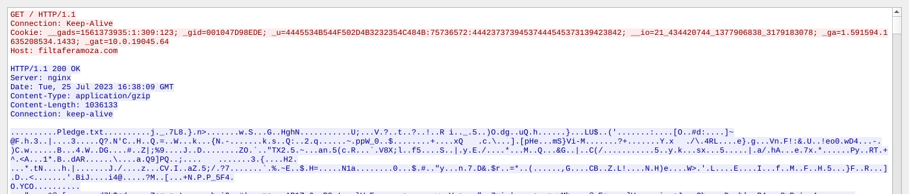
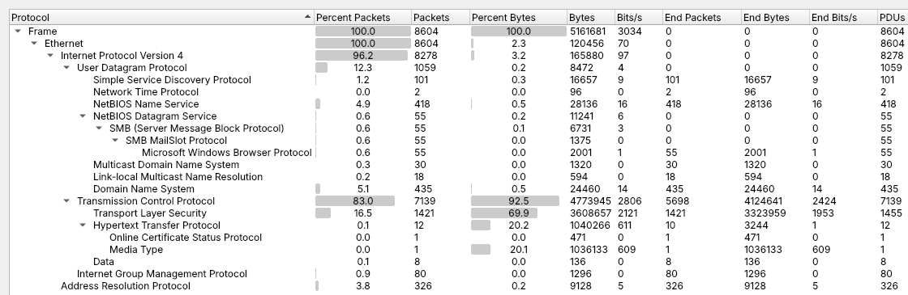
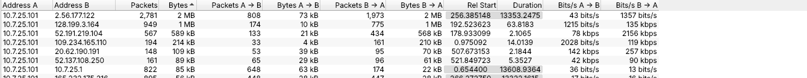
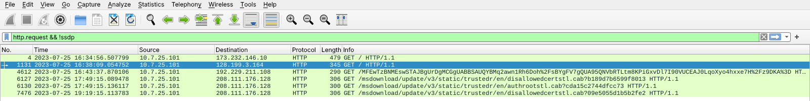
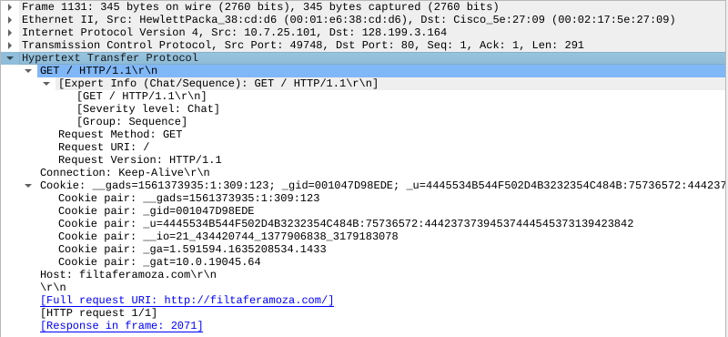
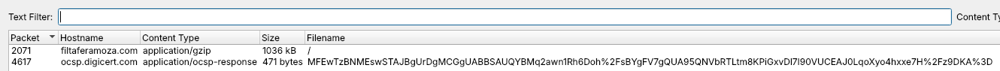
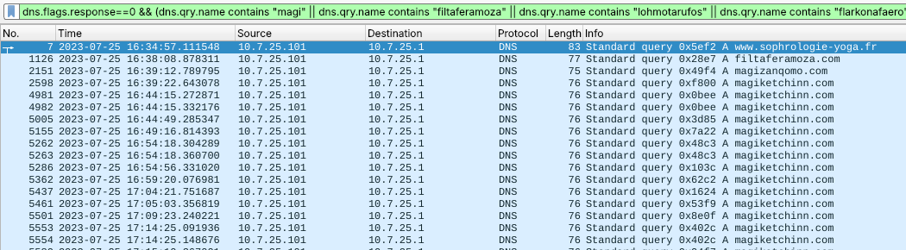
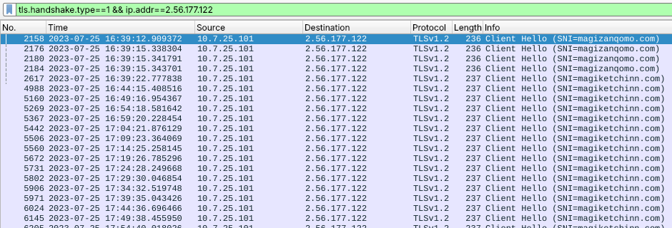
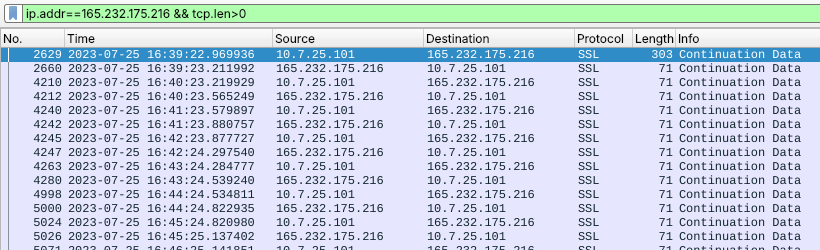

# Homework 3.3 – Network Traffic Analysis with Wireshark

CS 6349 Network Security &nbsp;·&nbsp; Amna Tahir &nbsp;·&nbsp; Worked solution &nbsp;·&nbsp; PCAP: <code>2023-07-25-IcedID-infection-traffic-1.pcap</code> (8,604 packets, 16:34:56 – 20:21:46 UTC) &nbsp;·&nbsp; Wireshark 4.2.2, times in UTC &nbsp;·&nbsp; Figures A1–A8 in the appendix

**Filters / features used:**

- Display filters: `http`, `http.request && !ssdp`, `dns`, `dns.flags.response==0`, `tls.handshake.type==1 && ip.addr==2.56.177.122`, `ip.addr==165.232.175.216 && tcp.len>0`
- Statistics → Protocol Hierarchy, Statistics → Conversations
- File → Export Objects → HTTP
- Follow → TCP Stream

## Part 1 – Protocol Overview (10 pts)

**Top 5 protocols by % of packets (Fig. A1):**

1. Ethernet 100 %
2. IPv4 96.2 %
3. TCP 83.0 %
4. TLS 16.5 %
5. UDP 12.3 %

Above the encapsulation layers the top protocols are TLS 16.5 %, DNS 5.1 %, NBNS 4.9 %, ARP 3.8 % and SSDP 1.2 %.

<b>Most data:</b> <b>TLS</b>, with 69.9 % of all bytes (3.61 MB) on top of TCP (92.5 % of bytes). HTTP is second at 20.2 %, and almost all of that is one 1.04 MB download.

**Conversations (Fig. A2):** the two IPs exchanging the most data are **10.7.25.101 ↔ 2.56.177.122** (2,781 packets, ≈2.34 MB over 3.7 h).

<b>Larger direction: 2.56.177.122 → 10.7.25.101</b> (B→A, ≈2.27 MB vs. 73 kB A→B). The external server is <i>sending</i> data to the internal host, so this is a download from the C2 server, not an upload.

Runner-up: 128.199.3.164 → 10.7.25.101 (1.08 MB over HTTP).

## Part 2 – HTTP Traffic Analysis (15 pts)

<b>Unique HTTP hosts: 4</b> – <code>173.232.146.10</code>, <code>filtaferamoza.com</code>, <code>ocsp.digicert.com</code>, <code>ctldl.windowsupdate.com</code> (Fig. A3). The <code>http</code> filter also shows SSDP <code>M-SEARCH</code> to <code>239.255.255.250:1900</code>. That is local UPnP discovery, not a web host; counting it gives 5.

| Time | Host | Request → Response | Verdict |
|---|---|---|---|
| 16:34:56 | 173.232.146.10 (raw IP) | `GET /` (Edge) → **302** to `https://www.sophrologie-yoga.fr/palatial` | Lure redirect |
| **16:38:09** | **filtaferamoza.com** (128.199.3.164) | **`GET /`, no User-Agent, IcedID cookie → 200 `application/gzip` 1,036,133 B** | **Malicious** |
| 16:43–19:19 | ocsp.digicert.com, ctldl.windowsupdate.com | OCSP check; cert-trust-list `.cab` (304) | Benign (Windows) |

**Suspicious request: `GET http://filtaferamoza.com/` (frame 1131, Fig. A4 and Figure 1).**

- It goes to a random-looking domain with **no User-Agent** and returns a binary.
- Its cookie is IcedID's beacon format. `_u=4445534B544F502D4B3232354C484B:75736572:…` decodes from hex to **`DESKTOP-K225LHK:user`** (hostname : username), and `_gat=10.0.19045.64` is the Windows build.

**Export Objects → HTTP (Fig. A5):**

- **Packet 2071 – filtaferamoza.com, `application/gzip`, 1,036 kB.** I exported it to an isolated folder only to hash it, and never ran it. SHA-256 `729a9743319f548134a1535291bea0bfdac6cd9a8c4c9ba19ab1b8524d5ebea7`. The gzip header claims "Pledge.txt", but the body **does not decompress**: it is IcedID's "fake gzip" that hides the encrypted payload.
- The only other object is a 471-byte OCSP response.
- **No `.exe`, `.zip` or `.php` crossed HTTP.** The executable is disguised as gzip. The first-stage file (≈201 kB from sophrologie-yoga.fr) came over **HTTPS**, so Export Objects cannot recover it.

## Part 3 – DNS and C2 Behavior (15 pts)

<b>Unique domain names: 33</b> queried, of which <b>28</b> were resolved with A records by the DNS server 10.7.25.1. The other 5 are local names – <code>wpad.localdomain</code>, <code>localdomain.localdomain</code>, <code>DESKTOP-K225LHK</code>(<code>.local</code>) – plus <code>pti.store.microsoft.com</code>, which got no answer.

**Random / suspicious domains (Fig. A6):**

| Domain | IP | Queries | Role |
|---|---|---|---|
| www.sophrologie-yoga.fr | 109.234.165.110 | 1 | Lure site (302 target) |
| **filtaferamoza.com** | 128.199.3.164 | 1 | IcedID payload server |
| **magizanqomo.com** | 2.56.177.122 | 7 | IcedID C2 |
| **magiketchinn.com** | 2.56.177.122 | **87** | IcedID C2 – beacon target |
| lohmotarufos.com, flarkonafaero.com | 140.99.221.138 | 5 + 5 | Backup C2, tried from 20:05 |

The `.com` names are invented, pronounceable strings, and several names share one IP. Everything else is Microsoft / Windows / Office / Bing telemetry.

**C2 example – periodic TLS beacon (Fig. A7).** Filter `tls.handshake.type==1 && ip.addr==2.56.177.122`:

- 45 Client Hellos to **magiketchinn.com**, a new session every **5 minutes**: mean 303.3 s, median 301.7 s, σ = 6.5 s.
- The server's certificate is self-signed (`CN=localhost, O=Internet Widgits Pty Ltd`).
- The first session pulled **≈2 MB** down to the host (follow-up modules).
- From 20:05 the server resets every connection, and the bot cycles through all four C2 names every 5 minutes.

A metronome-regular check-in like this is classic **beaconing**.

**Second C2 channel – 165.232.175.216:443 (Fig. A8).** Follow TCP Stream shows **no TLS handshake**; Wireshark can only call the packets "SSL Continuation Data". After a 249-byte opening message, client and server exchange a **17-byte message every 60 s** (220 times) for 3.4 hours to a raw IP. This matches IcedID's **BackConnect** remote-access module.

**Exfiltration:** no large upload occurred; the external side always sent more. What *was* exfiltrated is the host profile in the IcedID cookie (hostname, username, bot ID, OS build).

Figure 1 – Follow → TCP Stream on the suspicious HTTP flow (tcp.stream eq 13). Red: the client's cookie-laden GET. Blue: the server's <code>200 OK, Content-Type: application/gzip, Content-Length: 1036133</code> and the binary "Pledge.txt" fake-gzip body.

## Part 4 – Comparison and Reflection (10 pts)

All three tools agree on the facts:

- victim 10.7.25.101, payload server filtaferamoza.com, C2 2.56.177.122;
- a 303.3 s mean beacon interval, measured identically in Wireshark and in Zeek ssl.log;
- 87 look-ups of magiketchinn.com (Wireshark count = Suricata custom-rule count).

| Indicator | Wireshark | Zeek | Suricata (ET) |
|---|---|---|---|
| IcedID payload download | Full content: cookie decoded, file exported and hashed | http/files.log: x-gzip, 1,036,133 B, no UA | **2 alerts naming IcedID** |
| Stolen host info in cookie | **Only here** (decoded by hand) | Not logged by default | Pattern matched, not decoded |
| Self-signed C2 cert | Per packet | **x509.log** – created 13:55 the same day | 45 alerts, but labelled "Not Suspicious" |
| 5-minute beaconing | Visible, needs manual timing | **Easy from ssl/conn timestamps** | Not detected |
| Non-TLS channel on 443 | "SSL Continuation Data" | **analyzer.log violation** + 3.4 h conn | No alert |

**Easier to identify visually in Wireshark:**

- payload content and context – the full HTTP conversation, the decoded cookie, the exported fake-gzip;
- the shape of the beacon – Client Hellos stacked exactly 5 minutes apart;
- the odd "SSL Continuation Data" packets that reveal fake TLS.

**Easier with logs:**

- **Suricata** names the malware family instantly from one request, without analyst effort, and my custom rule turned an IOC into a detection.
- **Zeek** condenses 8,604 packets into a few hundred records, so top talkers, beacon intervals, certificate fields, protocol violations and upload/download ratios can be queried directly.

Suricata misses behavior it has no rule for, Zeek gives no verdict, and Wireshark doesn't scale. A SOC alerts with Suricata, hunts with Zeek and proves the case in Wireshark.

## Appendix – Screenshots

A1 – Statistics → Protocol Hierarchy.

A2 – Statistics → Conversations → IPv4, sorted by bytes.

A3 – Filter <code>http.request && !ssdp</code>: the six HTTP requests (frame 1131 selected).

{: style="width:62%"}

A4 – Frame 1131 headers: IcedID cookie, no User-Agent, Host filtaferamoza.com.

A5 – File → Export Objects → HTTP.

{: style="width:80%"}

A6 – Suspicious DNS queries in order: lure → payload → C2 → repeated C2 look-ups.

{: style="width:75%"}

A7 – TLS Client Hellos to 2.56.177.122 every ~5 minutes (16:39, 16:44, 16:49, …).

{: style="width:68%"}

A8 – 165.232.175.216:443: 17-byte "SSL Continuation Data" every 60 s, with no TLS handshake.

